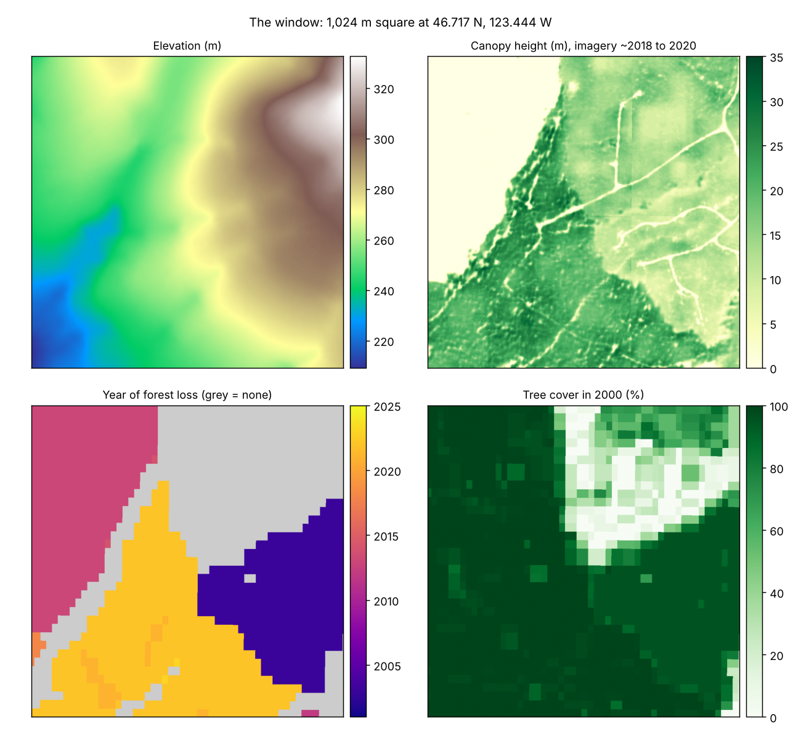
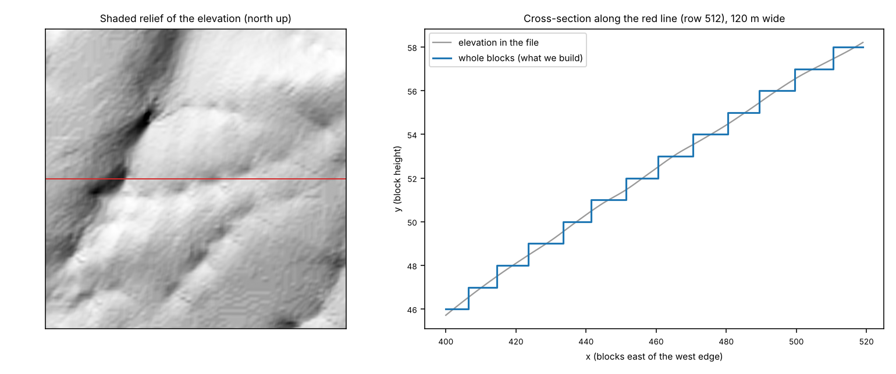
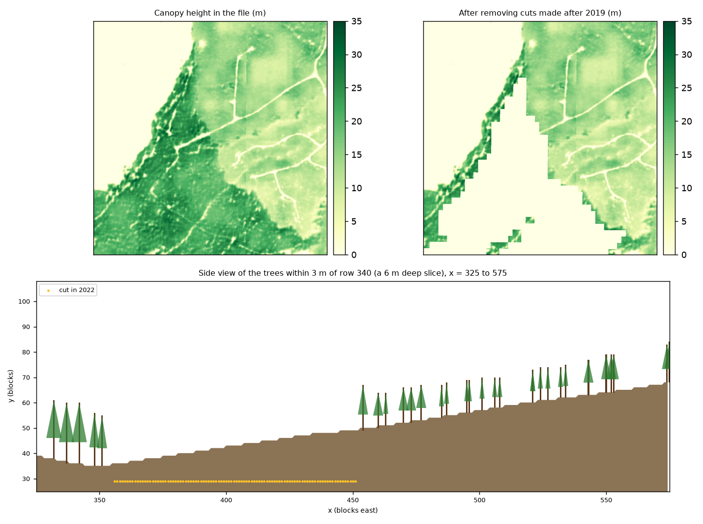
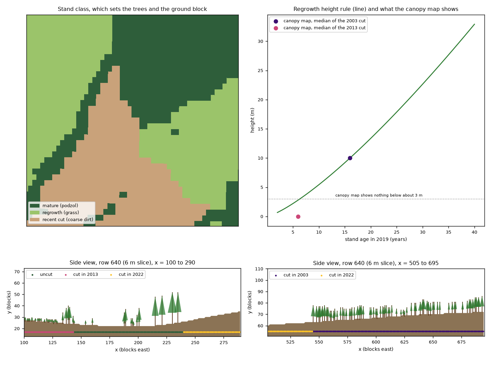

# Tutorial: Bringing geospatial data into Minecraft

This tutorial demonstrates how to create Minecraft worlds that utilize real world geospatial data. 

The motivating example is a 1 km block of timberland in the Pacific Northwest, USA. It includes mature and young forest, as well as recent clearcuts, to demonstrate how different types of continuous and categorical spatial data can be rendered in the game. Each block will represent 1 meter of real world space. 

This tutorial uses Earth Engine for data access and python for processing the data layers and converting to formats Minecraft can recognize. You do not need Minecraft itself to run the tutorial, just to view and explore the world when it's done. 

## Contents
1. [What we are building and why one block per metre](#1-what-we-are-building)
2. [The data](#2-the-data)
3. Looking at the raster *(next)*
4. Terrain *(next)*
5. Trees *(next)*
6. Ground by stand age *(next)*
7. Writing the world files *(next)*
8. `level.dat` and the version number *(next)*
9. Checking the result *(next)*
10. Opening it in the game, and what to be honest about *(next)*

## 1. What we are building

Minecraft generates new worlds by default, using its own internal logic. We are going to generate a map that is built with real world geospatial data instead. To do this, we'll use three layers:

- **Elevation data** to set the ground height.
- **A canopy height map** to locate trees and determine their height above ground.
- **A year of forest loss map** to categorize different forest conditions, so structural changes will be easy to see in the rendered world.

**Why one block per metre.** Minecraft's blocks are one cubic metre by design, and the canopy height map we will use is itself at 1 m, so we won't need to do any resampling to align with the resolution of the data. But, you can scale imported datasets differently for other applications. 

**A limit to know about early.** The game builds from -64 to 320, 384 blocks tall. A kilometre of mountainous ground can span more than that, so we use heights relative to the lowest point in the window and check the range before we write anything.

**What this is not.** The goal of this tutorial is to show how geospatial layers can be brought into Minecraft and rendered in a way that makes them explorable. The focus is on making sure the data "looks right" and represents real world structure. It is a visual tool, not an accurate measurement.

## 2. The data

We use three public layers, all free to use with credit (full table and citations in [`data/SOURCES.md`](data/SOURCES.md)):

| Layer | What it gives | Resolution |
|---|---|---|
| USGS 3DEP | Bare-earth elevation from lidar | 1 m where lidar exists, otherwise 10 m |
| Meta/WRI canopy height | Height of the tallest vegetation, estimated from satellite photographs | 1 m |
| Hansen Global Forest Change | Year each area lost its forest, 2001 to 2025 | about 28 m |

The canopy height map is a model's estimate and not a lidar measurement, and most of its imagery dates from 2018 to 2020. Hansen's loss year is coarse, so small cuts are missed. Bear in mind that the Minecraft map will carry these limitations forward. 

### Getting the window out of Earth Engine

I have included all necessary datasets for our example patch in [`data/`](data/), so if you want to get right to world building you can skip this step. However, if you'd like to replace it with your own site you can follow these steps to render a different 1 km window anywhere in the continental US:

1. Open [`ee/export_aoi.js`](ee/export_aoi.js) in the Earth Engine Code Editor and press Run once. It adds the Hansen loss layer to the map (yellow for old loss, purple for recent).
2. Pan and zoom to a patchwork of clearcuts of different ages, then leave the map centred where you want the window. The script takes the map centre as the middle of a 1,024 m square.
3. Press Run again, then start the export in the Tasks tab. It writes one GeoTIFF with five bands: `dem3dep1m`, `dem3dep10m`, `canopy_h`, `loss_year`, `treecover2000`. Note we will use the 1m DEM, but we're also getting the 10m product as a fallback; Earth Engine cannot tell you in advance whether your site will have 1m coverage. 

The script exports in UTM, the metric map projection for the area, at a scale of exactly 1 m. This is what makes one pixel equal one block. Missing values are -9999 (for elevation and height) so that "no data" is never mistaken for "zero metres".

Next: [3. Looking at the raster](#3-looking-at-the-raster-next).

### Looking at the rasters
Before we start processing the data, let's have a look at our rasters so we know what to expect. The Minecraft world will be downstream of this step, so it's worth making sure the data are free of errors and that the grid is as expected. This repo includes a short diagnostic script which you can run as:

```
python scripts/03_inspect_raster.py
```

It prints a short report and writes two pictures. We will go through what each one tells us.

#### Is the grid as expected?
The report provides checks that the grid is in a metric coordinate system (UTM zone 10N) and that each cell is 1m. Our grid is 1,024 by, 1,024 cells, so our rendered world will represent an area a little over one square kilometer. 

The report also includes a matrix to show which layers in the combined .tif file contain real data:

band            valid %      min      max     mean
dem3dep1m           0.0        -        -        -
dem3dep10m        100.0    209.2    332.5    267.2
canopy_h          100.0      0.0     34.0     12.6
loss_year         100.0      0.0   2023.0   1344.7
treecover2000     100.0      0.0    100.0     81.2

This is mainly useful for checking which DEM to build the world off of. You can see that for our chosen block there is no 1m DEM coverage, so we will use the 10m layer instead. 

Here's an overview of the data layers:



*Figure 1. The four layers over the same 1,024 m square.*

- **Elevation**: The block includes a ridge in the upper right, and drops down to a stream valley in the lower left. Minecraft's vertical axis is confined from -64 to 320, or a total of 384 blocks. With 123m of relief plus up to 34m of trees we will have room to spare. But this is a limitation to be aware of: blocks with very steep elevational gradients will get clipped. 

- **Canopy height**: Dark green shows taller forest, while pale green is short grading to no trees. The canopy height map I used stops at 34m, so some of the very tall Douglas fir trees that grow in this part of the world will be clipped as well. 

- **Year of forest loss**: This is the layer that tells us where the forest was cut and when. The colours are years: dark purple for the early 2000s, pink for the 2010s, yellow for about 2022, grey for no cut. Compare it with the canopy panel above. The pink block in the upper left lines up with the bare triangle, which is how the canopy map shows a cut from the 2010s: the replanted trees are still too small for the model to see.

- **Tree cover in 2000**: A baseline from the start of the record. The pale patch in the upper middle was not forested in 2000 and sits in a region that shows no cut afterwards, which suggests it was cleared before the record began and has regrown since. That is my reading from the maps, not something the files state, so treat it as a guess.

If you examine the data closely, you'll notice that there are some spots with predicted harvest yet standing trees per the canopy map. These are simply cases where harvests happened after the aerial imagery underpinning the canopy heights was taken after the harvests occur. We will follow the forest loss map. 


## 4. Turn elevation into blocks

Now that we know the data are usable, it's time to turn it into the thing Minecraft actually needs to build the world: for every column of the grid, the height of the top ground block, as a whole number. This will be the basis for the trees or any other details that we'll add later. 

To convert the DEM into Minecraft's ground layer run:

```
python scripts/04_build_terrain.py
```

### Orient the elevation data in space

We need to tell Minecraft how we want to position the actual elevation measurements within the world's grid. Here's the conventions we'll use:

**One block is one metre.** Each 1 m cell of the raster becomes one column of blocks, so our world will have 1,024 blocks on each side. 

**Rows and columns are already world coordinates.** Raster row `r` becomes world `z = r`, and column `c` becomes world `x = c`. Row 0 is the north edge of the map. Minecraft's z axis also grows toward the south, so a map with north at the top needs no flipping. Writing this down now keeps use from accidentally producing a mirrored world later.

**The lowest ground sits at y = 0.** The world extends down to y = -64, so that leaves 64 blocks of stone below the lowest spot. In code the conversion is one line:

```python
y = np.round(dem - dem.min()).astype(int) + Y_BASE   # Y_BASE = 0
```

### Does it fit?

The ```build_terrain.py``` script includes some checks to make sure the data block will fit within the limits of the game. In our data, ground runs from y = 0 to y = 123. The tallest tree on the canopy layer is 34 m, so even if it stood on the highest ground, its top would be at y = 157, well under the limit of 319.

```
Ground height in blocks: y = 0 to 123 (123 blocks of relief)
Tallest tree top if stood on the highest ground: y = 157 (limit 319)
```

If you choose a landscape that is too steep to fit into the game's constraints, the script will fail with an error. In this workflow, you will have to choose a different area with lower relief instead. 

### Do we need to smooth it?

The DEM export chunk above will use 1m LiDAR data with no smoothing if it's available, and defaults to the 10m product with a simple elevational ramp if not. This is purely to improve the visuals of the world, and therefore assumes that no subsequent analysis will be run on it. On this landscape no additional smoothing was necessary, though you may come to a different conclusion if you test it in other geographies. 

### What whole blocks do to gentle slopes

Minecraft worlds typically have slopes that progress one block at a time, so that you can traverse them without having to jump. It's worth verifying that our world will do the same:



*Figure 3. The elevational cross-section over 120 m. The grey line is the elevation in the file and the blue steps are the blocks we will build.*

A slope of about one metre in ten becomes a staircase of flat treads roughly ten blocks wide. Across the whole window the median tread is 9 blocks wide (the middle 80% of treads run from 5 to 19). The script also measures how steep the world feels to walk in:

```
flat (0 blocks)               79.5% of columns
one block (walkable)          20.5% of columns
two or more (needs a jump)     0.0% of columns
```

No column differs from its neighbours by more than one block, so a player can walk the whole world without jumping. 

### What this terrain cannot show

The elevation here comes from the 10 m model, so features smaller than about ten metres are missing: stream banks, cut banks beside roads, etc. If your window has 1 m lidar, the same script picks it up automatically and the terrain will show those details. If your ground is very flat, the whole-block step may erase real relief, and you could scale heights up, for example two blocks per metre. This window does not need it.

The script saves the grid to `out/surface_y.npy`. 


## 5. Decide where the trees go

We now have the ground level and it's time to put some trees on it. A tree in Minecraft is just blocks, but to create realistic models we need to know location, height, and crown width for every tree we will map. This can be worked up as a simple table, which will provide the mapping and dimensions of all of the trees we will place in the world. 

Running this script will generate the placement:

```
python scripts/05_place_trees.py
```

### Make sure the canopy map is overridden by recent forest loss

In chunk 3 we saw that the canopy layer and the forest-loss layer are from different dates. The canopy map comes from imagery taken around 2018 to 2020, so any ground cut afterwards still shows trees. To avoid placing trees in clearcuts, we will establish a simple rule: wherever the loss year is later than 2019, the canopy is set to zero.

```python
out[loss > IMAGERY_YEAR] = 0.0
```

Cuts made before 2019 need no correction, because the imagery already shows them: the cut from 2013 is bare in the canopy map, and the cut from 2003 shows young trees.



*Figure 4. Top: canopy height in the file (left) and after removing the cuts made after 2019 (right). Bottom: a side view of the trees within 3 m of one row of the window, crossing from standing forest into the 2022 cut. The yellow dots mark the cut.*

In the top row, the bright triangle that appears on the right is the 2022 cut, with the blocky edge of the loss map. Overall, 28.2% of the window was cut after 2019, and the mean canopy height drops from 12.6 m to 6.6 m.

### Place one tree per square

For this example, we'll stick with a simple set of placement rules. First, divide the window into 6 m squares, then in each square pick one random point. If the canopy at that point is 3 m or taller, put a tree there with that height. Below 3 m we treat the vegetation as shrubs or seedlings and draw nothing. The random seed in the example is fixed so that the same forest configuration will regenerate every time. 

Each tree has a crown whose half-width is about a ninth of its height, between 1 and 4 blocks. The crown is a cone that starts a third of the way up the trunk and narrows to a point at the top. The script writes one row per tree to `out/trees.csv`: position, ground height, tree height, crown radius and loss year.

The result for this window:

```
Trees placed: 14,252 (136 per hectare over the whole window), one candidate per 6 m square.
Height of placed trees: median 13 blocks, 90th percentile 20, tallest 33.
```

### Check it against the stands

The most useful check is by cohort, because it tests the correction directly.

```
loss year    area %  trees/ha  median h
none           33.2       264        15
2003           17.7       264        10
2013           20.3         2        10
2021            1.5         0         -
2022           26.7         0         -
```

The 2021 and 2022 cuts have no trees, which is what we wanted. The uncut forest and the 2003 stand both come out at about 264 trees per hectare, which is the density the grid gives wherever the canopy is tall enough. The 2013 cut has two trees per hectare. The loss map is blocky, so a few trees from neighbouring stands leak across its edges.

### What does this tree placement represent?

It's worth being clear that the result is a representation of the canopy height layer that will translate nicely to Minecraft, not a forest inventory. Every stand gets the same one-tree-per-square treatment, so the densities above are not telling us anything about the actual stand structure. Real young stands are typically much denser than old ones, so the 2003 stand is too sparse here. The 2013 stand, bare because its trees are too small for the canopy model to see, should really be a thicket of saplings, and the script draws nothing there. Chunk 6 gives each stand its own treatment, using its age.

The block grid structure of Minecraft limits how accurately you can reflect real stand conditions, but the simple rules used in ```05_place_trees.py``` can be modified. It would be worth experimenting with other placement rules that are more biologically realistic. 

In total the table describes about 0.7 million blocks of trunk and leaves, under one block per ground column on average. That is a light load for Minecraft.


## 6. Treat each stand by its age

We are nearly ready to export the world, but let's do a little more styling to improve its visuals first. The previous script treated every patch of forest the same way, but real world forests differ in look and structure based on their age. Our window holds old uncut forest, two stands that grew back after earlier cuts, and ground that was cut after the canopy imagery was taken. Each looks different in Minecraft, and each needs its own trees and its own ground block.

Our next script will apply some additional visual tweaks, so that these differences are obvious:
```
python scripts/06_stands_and_ground.py
```

### Sort the window into three classes

The forest-loss layer gives the year each cell was cut. The canopy imagery is from about 2019. That gives three classes:

| Class | Rule | Ground block |
|---|---|---|
| Mature | never cut in the loss record | podzol |
| Regrowth | cut in 2019 or earlier | grass block |
| Recent cut | cut after 2019 | coarse dirt |

Podzol is the dark forest floor under conifers in Minecraft, grass suits young regrowth, and coarse dirt reads as bare disturbed soil. The script saves the class of every column in `out/ground.npy`. Chunk 7 turns the classes into blocks.



*Figure 5. Top left: the three classes. Top right: how tall regrowth is, by age. Bottom: side views across stand boundaries along one row.*

### Give regrowth a height and a density

Regrowth needs two numbers, and the canopy map supplies only part of the answer. Where the map shows a tree 3 m or taller, we use that height. Where it shows nothing, we still know the stand's age, so we use a growth curve.

The two regrowth stands show why we need it. The stand cut in 2003 was 16 years old in 2019, and the canopy map gives a median height of 10 m. The stand cut in 2013 was 6 years old, and the canopy map shows almost nothing, since only 1% of its cells reach 3 m. The model cannot see trees that small, but they are there.

The growth curve in the top-right panel passes through the 2003 point and is shaped so that a 6-year-old stand comes out at 2.8 m, just under what the map can see.

```python
height = 10.0 * (age / 16) ** 1.3
```

Young stands are also crowded. We give each stand a number of stems per hectare that falls with age: 1,100 at age 5, 600 at age 20, 400 at age 40, and 280 in uncut forest. The script lays down a candidate tree in every 3 m square, then keeps a random share of them to match the stand's density.

### Check it

```
stand          area %  trees/ha  median h    ground block
mature           33.2       271        15          podzol
cut 2003         17.7       714        10     grass_block
cut 2013         20.3      1060         3     grass_block
cut 2021          1.5         0         -     coarse_dirt
cut 2022         26.7         0         -     coarse_dirt
```

The window now holds 45,848 trees, about 437 per hectare. That is about 1.1 million blocks of trunk and leaves, roughly double chunk 5, almost all of it from the young stands.

In the side views, the 2013 stand is a thicket of 3-block saplings next to old trees 20 to 30 blocks tall. In the right-hand view, the 2022 clearcut meets the 2003 stand, whose trees are about 10 blocks tall.

### Be honest about what is guessed

The one measured thing here is the 2003 point on the growth curve. The exponent, the stem densities and the ground blocks are our assumptions. The densities are typical for conifer regrowth, but they are not taken from a survey of this site. If you know a local source, replace the numbers in the `DENSITY_BY_AGE` table at the top of the script and rerun.


## 7. Write the world

Everything so far has been a table or a raster. This chunk turns them into blocks and saves them in the file format Minecraft reads. The world will not open yet, because it still lacks its `level.dat` file. We'll add that next.

```
python scripts/07_write_world.py
```

### How Minecraft stores a world

Minecraft stores terrain in **region files**, one per 512 × 512 block square. Our window is 1,024 × 1,024 blocks, so it needs four: `r.0.0.mca`, `r.1.0.mca`, `r.0.1.mca` and `r.1.1.mca`.

A region file holds 32 × 32 **chunks**, and each chunk is a 16 × 16 column of blocks that is 384 blocks tall (y from -64 to 319). A chunk is split into 24 **sections**, each 16 blocks tall.

Each section lists the kinds of block it contains, its **palette**, and then gives one palette number for every block. A section that is all air needs only a one-entry palette and no block list at all. The block numbers are packed into 64-bit integers, using as few bits per block as the palette allows (never fewer than 4), and one number never straddles two integers.

The `nbtlib` package writes the chunk data (the format is called NBT), and the script adds the region-file wrapper itself: a header of chunk locations, then the chunks, each compressed with zlib and padded to 4,096 bytes.

### Build one chunk

For each chunk, the script fills the ground column by column from the surface height we computed in chunk 4:

| Depth | Block |
|---|---|
| y = -64 | bedrock |
| down to 4 blocks below the surface | stone |
| the 3 blocks under the surface | dirt |
| the surface block | podzol, grass block or coarse dirt, by the stand class from chunk 6 |

Then it adds the trees. Each tree is a spruce trunk with a cone of spruce leaves, using the tree's height and crown radius from `out/trees.csv`. A tree is just a template, a list of block offsets from its base, and there are fewer than a hundred distinct templates, so the script builds each one once and stamps it out.

Two details matter. Leaves are written with `persistent: true`, because leaves that nothing attached them to would otherwise decay and vanish within minutes. And a tree never overwrites ground: a crown that leans over a slope stops where the hillside starts, and a trunk always wins over a neighbour's leaves.

### Use an older data version on purpose

Every chunk carries a `DataVersion` number. Java 26.3 is 5023. The script stamps chunks with 3953 (Minecraft 1.21) instead, and the game upgrades them when it loads each chunk. The reason is that the chunk layout has kept the same shape since version 1.18, but the newest versions have renamed some fields, and an old version number is the safe way to avoid guessing the new names. If you would rather write the newest version directly, `CHUNK_DATA_VERSION` is a constant at the top of the script.

### Check what was written

The script's own output only says that chunks were written. To check the content, we read some back with a separate piece of code that decodes the files straight from the format description:

```
columns checked: 6400, wrong: 0
tallest tree: 31 trunk blocks (expected 31), a leaf at the tip
```

That is 25 random chunks, with every column's surface block, soil layers, bedrock and above-ground blocks matching the inputs. This is a check of the file, not of the game. Whether Minecraft accepts the files is something only opening the world can tell us, which chunk 10 does.

## 8. Open the world in Minecraft

Now it's time to open our world!

We now have region files, but a Minecraft save also needs a `level.dat` file holding the seed, the spawn point and the game rules. We could write that file by hand, but its contents change between Minecraft versions, and a wrong file means a world that will not open. So we let the game write it, and copy our region files into the save it creates.

I will warn you that this part is a bit fiddly. I haven't yet figured out a completely clean workflow for starting a new game with the world, so this is a bit of a workaround. If anyone develops a better approach be sure to let me know. 

### First, create an empty world

1. Start Minecraft Java Edition 26.3 and choose **Create New World**.
2. On the **World** tab, set **World Type** to **Superflat**.
3. On the **More** tab, turn on **Allow Commands** (cheats). You will need one command later.
4. Create the world, let it load, then save and quit to the title screen. The world must be closed before the next step.

### Copy our world into it

First, run this:

```
python scripts/08_install_world.py "<path to the save folder>"
```

The save folder is the world's folder inside Minecraft's `saves` directory:

| System | Location |
|---|---|
| Mac | `~/Library/Application Support/minecraft/saves/<world name>` |
| Windows | `%APPDATA%\.minecraft\saves\<world name>` |
| Linux | `~/.minecraft/saves/<world name>` |

The script finds the right folder inside the save and renames the old region folder to `region_original`, so nothing is deleted. Since Java 26.1 the overworld's regions live in `dimensions/minecraft/overworld/region/`, and before that in `region/`. The script checks which layout the save uses.

It refuses to run in a save that is missing `level.dat`, and in one it has already installed into, so a second run cannot overwrite the first.

If you're running these scripts on a remote IDE such as a Github codespace etc. you can download the ```out/world.zip``` object and copy the files over by hand. 

### Open it and move to the forest

Open the world from the single-player list. You may start underground, because the new world's spawn point sits at flat ground level, about y = -60, and our terrain now fills that space. The script printed a command with the coordinates of the window's centre. Type it in the chat:

```
/tp @s 512 59 512
```

You should now be standing in the forest, with ground that ends at the edge of the 1,024-block square. The first load can be slow, because the game computes lighting for every chunk it has not seen before. It also upgrades each chunk to the current format, because chunk 7 wrote them with an older data version. You may also want to set the world spawn with `/setworldspawn 512 59 512`.

### Optional: run it on a Paper server

If you want a server `scripts/08b_make_server_folder.py` builds a ready server folder from the same world, including a `server.properties` with flat world settings and no mobs. Download Paper for 26.3, run it once, accept the EULA in `eula.txt` yourself, and run it again. The script prints the commands for setting the spawn. I've found this approach to be smoother than the above, but it does require another softeware dependency and some additional setup. 

## 9. Check the world

Opening the game tells you whether a world loads, but not whether it looks right. This chunk gives a check you can run before you open anything, and again whenever you change a script.

```
python scripts/09_check_world.py
```

### What it checks

The script reads every chunk back out of the region files and compares it with the three tables that produced it to check four things:

| Check | What counts as passing |
|---|---|
| Chunks | all 4,096 are there, each in the right place, each marked complete |
| Every column | bedrock at the bottom, then stone, then 3 blocks of dirt, then the surface block for its stand class, with no air underground and only air, trunks and leaves above it |
| Every tree | the whole trunk is there, from the block above the ground up to two blocks below the tip, where the leaf cap starts |
| Logs | the world holds exactly as many log blocks as the trees table implies |

It does not check the leaves exactly. Neighbouring crowns overlap, and a crown stops where a hillside starts, so the number of leaf blocks cannot be predicted from the table alone. It reports the count and leaves it at that.

### Read the result

```
Chunks found: 4096 of 4096. DataVersion in the chunks: [3953].
Columns with the wrong blocks: 0 of 1,048,576.
Trees: 45,848 in the table, 0 with a missing trunk block.
Log blocks: 267,914 in the world, 267,914 expected from the trees table.
Leaf blocks: 1,333,433 in the world (not checked exactly, ...).

PASS
```

If anything fails, the script prints the first 20 problems, each with the block position, then ends with `FAIL`. It also exits with an error status, so you can use it in an automated check.

### What this does not tell you

The check shows that the files hold what the tables say. It does not show that the tables look like a forest. Chunk 10 deals with that, and so does walking around in the game.


## 10. Explore!

Once these checks are passing, it's time open the world and explore. This is partially for fun, but may also reveal more subtle visualization issues that our automatic checks missed. Fixing such anamolies will likely involve going back to the rules we used to generate the terrain, landcover types, and trees. When I was working through this I noticed some odd distortions to the way the tree canopies rendered that I had to go back and fix. If you adapt this script to other sites I would anticipate finding similar artifacts. 

The world opens, the files check out, and the trees look like a forest. Before you use it for anything, keep in mind what it is and what it is not. It is a 3D rendering of four public datasets, drawn at one block per metre. It is not a forest inventory, and the gaps between the datasets and the world are the useful part to understand.

### What each piece is, and what it assumes

| Part of the world | Where it comes from | What to keep in mind |
|---|---|---|
| Ground shape | USGS 10 m elevation, because the 1 m lidar layer was empty over this window | Terraces about 9 blocks wide (median), because 10 m data is rounded to whole blocks. Lidar would give finer steps. |
| Tree heights | A canopy height model estimated from satellite photographs taken around 2018 to 2020 | An estimate, not a lidar measurement. Heights stop at about 34 m in this window. |
| Which ground was cut, and when | Hansen forest-loss map at about 28 m | Small cuts are missed, edges are blocky, and a few trees leak across the edge of the 2013 cut. |
| Tree positions | One random candidate per 3 m square, thinned to a density per stand | The positions are random, not surveyed. No real tree is at any of these spots. |
| Regrowth heights and stem counts | A growth curve through one measured point, and assumed densities | These are the weakest numbers in the world. See chunk 6. |
| Species | Every tree is a spruce | A placeholder. The data does not tell us the species. |
| Ground blocks | Three choices by stand class | Podzol, grass and coarse dirt are looks, not soil measurements. |
| What is missing | Understory, stumps, fallen logs, dead standing trees, streams, roads | None of these are in the datasets we used. |

And of course, keep in mind this is a snapshot world with the tree heights dated to the 2018/2019 imagery used to generate the canopy height map. 

### What can you use this for?

Well, first of all for fun! If you have someone in your life who loves Minecraft they will probably enjoy exploring a custom world you built. And even if you are not a Minecrafter I suggest having a look around yourself. 

But, I do think it can provide us with some helpful information too. It shows us the shape of the stands, the size and configuration of clearcuts, and how different ground conditions are related to one another in space. It could be useful for catching physical barriers, such as steep ravines, that might complicate an inventory plot layout. I've been using it to sanity check ecological model simulations, since I can pretty quickly output a world I can walk around. And of course, it could make for a great teaching tool. 

It is not going to be helpful for counting trees, estimating carbon, or checking a model against the ground. In this world, the tree positions are invented and the regrowth numbers are assumed. I am sure you can get more of the real stand dynamics into the game, but the 1m grid size is always going to be a constraint on how realistic the results are. A more sophisticated visualization platform would be necessary to see accurate fine-scale stand structure. 

### How big can the window be

On the example window, each step is quick:

| Step | Time | Output |
|---|---|---|
| chunk 4, terrain | about 1 s | `surface_y.npy` |
| chunk 6, stands and trees | about 1 s | `trees.csv`, 45,848 trees |
| chunk 7, write the world | about 10 s | 17 MB of region files, 3 MB zipped |
| chunk 9, check | about 5 s | pass or fail |

Peak memory was about 300 MB. The input raster is 2.6 MB.

Bigger areas will probably require some clever data slicing and dicing. I'm sure it's possible, but I haven't tested it yet. Keep in mind however that each region file is around 4 mb, and there's also the processing of all those raster data to consider, so really big projects could be challenging. 

### Use your own site

The scripts in this repo can be adapted for any site. Here are the things to change:

| What | Where |
|---|---|
| The area and the exported layers | the Earth Engine script from chunk 2 |
| The year of the canopy imagery | `IMAGERY_YEAR` in chunks 5 and 6 |
| The stem density and growth curve for your forest type | the constants at the top of `06_stands_and_ground.py` |
| The trees' look and the biome | `tree_template` and `BIOME` in `07_write_world.py` |
| The coordinate system | check the export is in a UTM zone that fits your site, because one cell must be one metre |

Re-run the checks after every change. Chunk 9 compares the finished world with your tables, so it tells you if a change broke the writer. Please keep in mind that you will likely have to do some work to reproduce the flow for new locations, especially those outside of the continental US where at a minimum you will need to identify a different elevation dataset. 

### What can go wrong

Here's a few issues I hit while building the example:

- **The world looks like the old version after you change a script.** Minecraft rewrites region files when it saves, so a file copied in while the game was running is overwritten. Quit the game completely before copying. If you move files between computers, compare `tail -c +8193 <file> | shasum` on both, and do it before the game has opened the world, because the game changes the files when it saves.
- **You start underground.** The new world's spawn is at flat ground level, so type the `/tp` command from chunk 8.
- **The commands are refused.** Turn on Allow Commands (cheats) when you create the world.
- **The world is plain flat land.** The region files are not in `dimensions/minecraft/overworld/region/`, or the game ignored them. Check the folder layout against your game version.
- **Chunk 9 says FAIL.** The message gives the block position of the first problems. Re-run chunk 7, and if it still fails, the cause is in your edit to the tables or to `07_write_world.py`.

### Ideas to try next

- Add stumps and slash to the recent cuts, so the coarse dirt does not look bare.
- Give each stand its own species mix, with different log and leaf blocks.
- Add an understory of ferns or shrubs under the older stands.
- Add standing dead trees, as bare logs with no leaves.
- Replace the assumed densities with plot data from your own site.
- Smooth the terraces, or use the 1 m lidar if your site has it.
- **Convert to bedrock**: If you prefer to play Minecraft on a handheld device, you can use an off-the-shelf tool such as Amulet to convert the Java build to Bedrock. 

### Licences and credit

Licenses and relevation info on the datasets I used can be found in `data/SOURCES.md`.